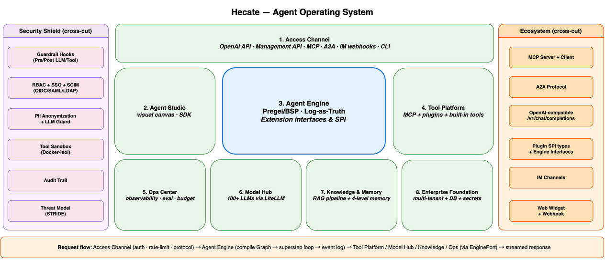

# Hecate

<div align="center">

**A self-hosted, MIT-licensed platform for enterprise agents and workflows — Python APIs, a visual canvas, and execution governance.**

[](https://github.com/xueyufish/hecate/actions/workflows/ci.yml)
[](https://www.python.org/downloads/)
[](https://opensource.org/licenses/MIT)
[](https://github.com/xueyufish/hecate)
[](https://modelcontextprotocol.io/)
[](https://a2a-protocol.org/)
[](https://platform.openai.com/docs/api-reference/chat)
[](https://github.com/xueyufish/hecate/blob/main/pyproject.toml)
[](https://github.com/xueyufish/hecate/blob/main/pyproject.toml)
[](https://github.com/xueyufish/hecate/blob/main/scripts/pre-commit.sh)

</div>

> **Hecate is alpha software.** APIs and config schemas may change before 1.0. Pin your version (`hecate==0.1.x`).

---

## Why Hecate?

Hecate brings agent execution, workflow design, and enterprise management into a modular platform for building intelligent applications:

- **High-code + low-code, one workflow** — Python API for engineers; drag-and-drop visual canvas for business users. Bidirectional JSON graph DSL sync — what you build visually is the same code-defined workflow.
- **Event-sourced execution (Log-as-Truth)** — Execution event logs, configurable checkpoint storage, and time-travel replay. Inspect recorded session timelines via `GET /api/sessions/{id}/replay`.
- **Recoverable agent execution** — An opt-in autonomous controller persists accepted decisions and reuses recorded action results across restarts. Durable retry, waiting, and approval support depend on the execution path and configured storage.
- **Enterprise governance capabilities** — Multi-tenant Org → Workspace → RBAC, SSO (OIDC/SAML/LDAP) + SCIM v2, audit trails, PII redaction, and sandbox integrations. Install and configure the capabilities required by your deployment.
- **Protocol-native** — MCP (server + client) + A2A (server + client) + OpenAI-compatible API. Wire-compatible with existing OpenAI clients.
- **Self-hosted storage and service choices** — Run Hecate on your infrastructure and choose cloud or local models. Conversation state, execution records, and evidence may be retained by configured stores; external model and tool calls follow the selected providers' data policies.

---

## At a glance



<sub>For the comprehensive L1 architecture with sub-components, see [architecture.md](docs/design/architecture.md).</sub>

### Current delivery and deployment options

Hecate remains **alpha**. The recoverable Agent Controller and the Pregel workflow executor are separate execution mechanisms that share execution and action components. Enable the controller with `"controller_loop": true` in a platform task's input or a Runner's `runner.json`; the Runner also requires its durable profile. Existing direct chat and graph paths remain in use; controller delivery does not switch all API entry points to the new loop.

| Component | Current scope |
|---|---|
| [Management platform](src/hecate/) | FastAPI APIs, Studio, tenant administration, and Task/Run submission, control, and observation |
| [hecate-runtime](packages/hecate-runtime/) | Independently consumable kernel with the Agent Controller, Pregel executor, and shared execution assembly |
| [hecate-durable](packages/hecate-durable/) | Persistent task, accepted-decision, action, lease, and event storage used by execution hosts |
| [hecate-runner](packages/hecate-runner/) | Standalone execution host that starts without platform management tables; technical preview with optional durable and managed profiles |

Development defaults use in-memory session/event stores and a stub durable backend. Configure persistent storage, identity, governance, and isolation for the execution path you use. Production support depends on the deployment profile and its verification evidence; see the [platform evolution plan](docs/refactor/enterprise-agent-platform-evolution-plan.md) for acceptance boundaries.

---

## How does Hecate compare?

| Dimension | **Hecate** | Dify | LangGraph | n8n | CrewAI |
|---|---|---|---|---|---|
| **Deployment** | Self-hosted OSS (MIT) | Cloud + self-host | OSS library | Cloud + self-host (Fair-code) | Cloud + enterprise |
| **Primary UX** | Code (Python) + Visual | Visual-first | Code (Python) | Visual + code | Code + Visual |
| **Engine** | Opt-in recoverable Agent Controller + **Pregel/BSP** workflows | DAG-based | Pregel (Google) inspired | DAG-based | Custom |
| **MCP server + client** | ✅ Bidirectional (latest spec) | ✅ Client only | Partial | ✅ | ✅ |
| **A2A protocol** | ✅ (server + client) | ❌ | ❌ | ❌ | Partial |
| **OpenAI-compatible API** | ✅ Wire-compatible | ❌ | ❌ | ❌ | ❌ |
| **Multi-tenancy native** | ✅ Org → Workspace → RBAC + SSO/SCIM | ✅ | ❌ Add-on | ✅ | ✅ |
| **Engine-level extensibility** | ✅ **Many interfaces + multiple SPIs** | Plugins | Decorators | Nodes | Limited |
| **License** | MIT | Apache-2.0 + cloud | MIT (LangGraph) + proprietary (LangSmith) | Sustainable Use License | Proprietary |

> Full comparison (vs Salesforce Agentforce, AWS Bedrock AgentCore, CrewAI, n8n, Chinese platforms, "Linux of agent platforms" framing): see **[Positioning & Competitive Landscape](docs/design/positioning.md)**.

### Pick Hecate when…

- ✅ **Self-hosted is required** (data residency, compliance, or cost reasons)
- ✅ **Multi-tenancy is required** (you build a platform for many teams / customers)
- ✅ **Protocol surface matters** (you need MCP, A2A, and OpenAI-compatible — not just one)
- ✅ **Engine-level extensibility is required** (you'll write a custom scheduler, guardrail hooks, or checkpoint store)
- ✅ **MIT-licensed OSS is required** (no per-seat fees, no telemetry)

### Pick something else when…

| If you want… | Choose |
|---|---|
| Non-developers building chatbots in days | **Dify** |
| A library, not a platform | **LangGraph** |
| General workflow automation (AI is a feature) | **n8n** |
| Managed cloud with sales motion | **CrewAI / Agentforce** |

---

## Quick Start

**Pick your path:**

| Goal | Where to start |
|---|---|
| 🧑‍💻 Build an agent runtime (Python API) | [One-command install](#one-command-install-recommended) below |
| 🎨 Compose workflows visually | [Start the visual dashboard](#start-the-visual-dashboard) after starting the backend |
| 📦 Embed an execution service in a business application | [Standalone Runner](packages/hecate-runner/) — technical preview |
| 🔌 Add MCP / A2A integration | [Enable MCP Server](docs/how-to/enable-mcp-server.md) · [Enable A2A Server](docs/how-to/enable-a2a-server.md) |
| 🏢 Deploy to production (K8s / multi-tenant) | [Deploy to production](docs/how-to/deploy-production.md) |

**Prerequisites**: Docker, Python 3.12+, [`uv`](https://docs.astral.sh/uv/), and credentials for your chosen LLM provider (OpenAI, Anthropic, DeepSeek, Qwen, GLM, Ollama, or any [LiteLLM-supported provider](https://docs.litellm.ai/docs/providers)); local providers may not require an API key. The visual dashboard also requires Node.js 20+ and npm. **System requirements**: 2 CPU cores, 4 GB RAM (8 GB recommended), 10 GB disk. macOS, Linux, and WSL2 supported; native Windows is experimental. Full guide: [Quickstart](docs/getting-started/quickstart.md).

### One-command install (recommended)

```bash
curl -fsSL https://raw.githubusercontent.com/xueyufish/hecate/main/install.sh | bash
```

This bootstraps the repo, ensures `uv`, copies `.env.example`, **interactively asks for an LLM provider key**, starts Docker Compose infra, runs Alembic migrations, and ends with `hecate preflight`. Then start the server yourself with `uv run uvicorn hecate.main:app --reload`.

> **By default the installer stops after validating the environment** — it does not auto-start the API server, so you can review `.env` first. Pass `--start-server` to additionally launch the `hecate` container and get Swagger live at `http://localhost:8000/docs`:
>
> ```bash
> curl -fsSL https://raw.githubusercontent.com/xueyufish/hecate/main/install.sh | bash -s -- --start-server
> ```

Windows: use [WSL2](https://learn.microsoft.com/en-us/windows/wsl/install) and run the same command, or follow the manual steps below. See [`scripts/install.ps1`](scripts/install.ps1) for the (currently stub) native PowerShell installer.

### Manual install (step-by-step)

If you'd rather drive each step yourself, here is the long form.

#### Step 1 — Start infrastructure and install

```bash
git clone https://github.com/xueyufish/hecate.git && cd hecate
# Create the .env file from the template (Docker Compose requires it; add your LLM API key here)
cp .env.example .env
# Start the infrastructure services (PostgreSQL, Qdrant, MinIO, Temporal)
docker compose -f docker/docker-compose.yml up -d postgres qdrant minio temporal
# Synchronize the locked development workspace (Windows and POSIX)
uv run --no-project --python 3.12 scripts/dev.py sync
# Activate the virtual environment (Git Bash on Windows: source .venv/Scripts/activate)
source .venv/bin/activate
# Apply database migrations
alembic upgrade head

# Sanity-check the setup before starting the server:
hecate preflight
# → [PASS] database: OK
# → [PASS] alembic_head: ...
# → [PASS] env_vars: all present
# → [PASS] llm_credentials: found: <your-provider-key>
# → Preflight PASSED.
```

#### Step 2 — Start the server

```bash
uvicorn hecate.main:app --reload
```

Open [http://localhost:8000/docs](http://localhost:8000/docs) for the interactive API explorer (Swagger UI) and `/redoc`.

#### Step 3 — Send your first chat request

The API is **OpenAI-compatible** — any existing OpenAI client works by pointing `base_url` at Hecate. Hecate accepts JWT tokens, database-backed API keys, or any value in the `HECATE_API_KEYS` env var (default `dev-key-change-me`):

```bash
curl -X POST http://localhost:8000/v1/chat/completions \
  -H "Authorization: Bearer $(grep ^HECATE_API_KEYS .env | cut -d= -f2 | cut -d, -f1)" \
  -H "Content-Type: application/json" \
  -d '{
    "model": "zai/glm-4.7-flash",
    "messages": [{"role": "user", "content": "Hello!"}]
  }'
```

**Expected response**: a JSON object with `choices[0].message.content` containing a greeting. If you see that, Hecate is running.

The `model` must match a provider key in your `.env` — Hecate routes via LiteLLM: `zai/glm-4.7-flash` uses `ZAI_API_KEY`, `gpt-4o` uses `OPENAI_API_KEY`, `anthropic/claude-3-5-sonnet-20241022` uses `ANTHROPIC_API_KEY`.

For streaming responses (SSE), add `"stream": true`:

```bash
curl -N -X POST http://localhost:8000/v1/chat/completions \
  -H "Authorization: Bearer $(grep ^HECATE_API_KEYS .env | cut -d= -f2 | cut -d, -f1)" \
  -H "Content-Type: application/json" \
  -d '{"model": "zai/glm-4.7-flash", "stream": true, "messages": [{"role": "user", "content": "Hello!"}]}'
```

`-N` disables curl buffering; tokens stream as they are generated.

#### Step 4 — Or use any OpenAI client (drop-in)

Hecate's `/v1/chat/completions` is wire-compatible with OpenAI. Any existing OpenAI client works by pointing `base_url` at Hecate — no code rewrite. Hecate authenticates the request via the `api_key` you pass to the client; for local development the value from `HECATE_API_KEYS` in your `.env` is the simplest choice:

```python
from openai import OpenAI

api_key = next(
    line.split("=", 1)[1].strip().split(",", 1)[0]
    for line in open(".env")
    if line.startswith("HECATE_API_KEYS=")
)

client = OpenAI(
    base_url="http://localhost:8000/v1",
    api_key=api_key,
)

resp = client.chat.completions.create(
    model="zai/glm-4.7-flash",
    messages=[{"role": "user", "content": "Hello!"}],
)
print(resp.choices[0].message.content)
```

Also works with `litellm`, `langchain-openai`, `instructor`, `vllm`, `llama-index` — any client that speaks OpenAI's wire protocol.

### Start the visual dashboard

Keep the backend running, then open another terminal from the repository root:

```bash
cd web
cp .env.example .env.local
npm ci
npm run dev
```

`NEXT_PUBLIC_API_URL` in `web/.env.local` selects the backend and defaults to `http://localhost:8000`. Open [http://localhost:3000](http://localhost:3000), register an account or sign in, then open **Workflows** to create or edit a workflow on the visual canvas. See the [visual canvas tutorial](docs/tutorials/11-visual-canvas.md) for workflow design.

### Troubleshooting

| Symptom | First thing to check |
|---|---|
| `hecate preflight` reports `database: FAIL` | `docker compose -f docker/docker-compose.yml ps` — is Postgres up? |
| `curl` returns `401 Unauthorized` | `cat .env` — is `HECATE_API_KEYS=` set (default `dev-key-change-me`)? The bearer must match `HECATE_API_KEYS`, a JWT, or a DB API key — `OPENAI_API_KEY` is the upstream LLM credential, not the Hecate auth token |
| `curl` returns `502 Bad Gateway` | `docker compose logs hecate` — the server may still be starting |
| Port `8000` already in use | `lsof -i :8000` then `kill <pid>`, or run uvicorn on `--port 8080` |
| Anything else | [Full troubleshooting guide](docs/how-to/troubleshoot.md) |

### What's next

**Tutorials** — feature-focused walkthroughs:

- [Build your first agent](docs/tutorials/01-first-agent.md) — code-first Python walkthrough
- [Add a knowledge base](docs/tutorials/02-knowledge-base.md) — RAG walkthrough
- [Connect an MCP server](docs/tutorials/03-mcp-integration.md) — extend with external tools
- [A2A Protocol](docs/tutorials/09-a2a-protocol.md) — cross-agent orchestration
- [OpenAI SDK compatibility](docs/tutorials/10-openai-compatibility.md) — use Hecate as a drop-in for OpenAI
- [Visual canvas](docs/tutorials/11-visual-canvas.md) — drag-and-drop workflow design

**Use cases** — end-to-end business scenarios:

- [Customer support bot](docs/use-cases/01-customer-support-bot.md) — RAG + Guardrails + HITL
- [Code review agent](docs/use-cases/02-code-review-agent.md) — MCP + Multi-Agent
- [Research team](docs/use-cases/03-research-team.md) — Multi-Agent + Streaming + Evaluation

---

## What you get out of the box

### Built-in tools

Hecate includes the following tool implementations. Availability depends on the agent's tool configuration, installed optional dependencies, and the selected execution environment:

| Tool | Risk | Purpose |
|---|---|---|
| `web_search` | LOW | Search the web for information |
| `read_file` | LOW | Read a file from the workspace root |
| `write_file` | MEDIUM | Write content to a file |
| `list_files` | LOW | List files and directories |
| `execute_code` | MEDIUM | Run Python in a sandboxed Docker container |
| `browser_navigate` | MEDIUM | Drive a headless Chromium to a URL (sandboxed, per-env allow-list) |
| `browser_click` | MEDIUM | Click an element on the current page |
| `browser_type` | MEDIUM | Type text into an input element |
| `browser_extract` | MEDIUM | Extract page content (a11y / text / HTML) |
| `browser_screenshot` | MEDIUM | Capture the page as PNG |
| `browser_fill_form` | MEDIUM | Atomically fill multiple form fields |

Browser tools run inside a dedicated Docker sandbox with per-environment domain allow-lists enforced fail-closed. See [Browser automation guide](docs/how-to/browser-automation.md).

### Graph collaboration patterns

Compose multi-agent workflows with graph templates. These patterns run on the workflow executor; the autonomous controller can advance without building a graph:

| Pattern | When |
|---|---|
| **Sequential** | Linear pipeline: each step feeds the next |
| **Parallel** | Fan-out / fan-in: independent tasks merged at the end |
| **Handoff** | Agent decides who handles the next turn |
| **Broadcast** | Multiple agents read/write a shared topic channel |
| **Negotiation** | Agents negotiate until a condition resolves |
| **Debate** | Agents argue in rounds until a winner emerges |
| **Dynamic** | A COORDINATOR node emits a TaskDAG at runtime |

### Engine extension interfaces and plugin SPI types

The full extension surface — see [Extension Points inventory](docs/reference/extension-points.md) and [Plugin concepts](docs/concepts/plugins.md).

---

## Features

Organized by layer:

### Protocol layer

- **A2A Protocol Native** — Linux Foundation standard — signed AgentCards (`/.well-known/agent-card.json`), JSON-RPC 2.0 task lifecycle, SSE streaming, and JWS+RFC 8785 trust model. Operates as both A2A server and A2A client.
- **MCP Native** — Bidirectional Model Context Protocol: Hecate consumes external MCP servers (GitHub, Slack, etc.) and exposes its own as a server (Streamable HTTP transport, latest MCP spec).
- **OpenAI SDK Drop-in** — Wire-compatible `/v1/chat/completions` endpoint. Any OpenAI client (Python, JS, litellm, langchain-openai, instructor, vllm) works against Hecate by changing `base_url`.

### Engine layer

- **Agent Controller and Workflow Executor** — The opt-in controller drives a recoverable model/action loop without graph compilation. Pregel/BSP executes explicit workflow graphs. Both use shared execution components; existing chat routes retain their configured execution paths.
- **Execution Guardrails** — Pre/post LLM and tool hooks support PII masking, audit logging, and human-in-the-loop flows. Coverage and enforcement depend on the selected execution path and configured policies.
- **Context Engineering** — An extensible pipeline (assembler, evidence tracker, phase detector, token budget, provider shaping, message prioritization, tool filtering, offloader) that keeps long-running agents on-budget and on-task.
- **Execution Replay** — Trace-partitioned timelines and time-travel state inspection over recorded execution events (Log-as-Truth, [ADR-030](docs/design/adr/030-event-sourced-execution-state.md)) via `GET /api/sessions/{id}/replay`. Timeline retention depends on the configured event store.
- **Sandbox Integrations** — Configurable local or Docker agent environments with permission scopes; browser tools use a dedicated Chromium sandbox with per-environment domain allow-lists. General agent environments default to the local backend.
- **Task/Run Control** — Task submission, run observation, control commands, and reconciliation APIs connect execution facts to the platform. Durable hosts retain accepted decisions and action results for recovery; a model's final answer is distinct from task acceptance.

### Platform layer

- **Multi-Tenant** — Organization → Workspace → RBAC with `workspace_id` on **many data models** for tenant isolation. SSO via OIDC/SAML/LDAP, SCIM v2 provisioning.
- **Visual Canvas** — Drag-and-drop workflow editor in `web/` (React Flow + Next.js). Bidirectional sync with the JSON graph DSL — what you build visually is the same code-defined workflow.
- **Multi-Agent Orchestration** — Static collaboration templates and dynamic TaskDAG orchestration on the workflow executor (see above).
- **Plugin System** — Multiple plugin types (Tool / Extension / Trigger / Model / Channel / Evaluator / Auth / Secret) with hot-reload, declared permissions, and versioned manifests.
- **Embeddable Web Widget** — Drop an agent chat into any web page via the `/embed/chat` iframe ([ADR-031](docs/design/adr/031-web-widget-iframe-architecture.md)), reusing the dashboard chat components with existing JWT auth.

### Integration layer

- **IM Channels** — Reach Hecate agents from Feishu (Lark) and Slack via inbound webhooks. Mandatory Bound Identity model ensures every IM user is bound to a Hecate user before any conversation starts. See [Configure Feishu and Slack](docs/how-to/configure-feishu-slack.md).
- **Webhooks** — Trigger workflows from external systems. See [Set up webhooks](docs/how-to/set-up-webhooks.md).

---

## Engineering Approach

Hecate's execution design combines these disciplines:

- **Harness engineering** — context assembly, model invocation, tool selection, and policy hooks support execution. Their composition follows the selected execution path.
- **Loop engineering** — the Agent Controller rebuilds continuation from persisted accepted decisions and recorded action results. It stops on a final answer, a wait, or explicit limits; the host owns task lifecycle and acceptance. Legacy chat loops remain available during entry-point migration.
- **Graph engineering** — a JSON DSL describes workflow nodes and edges; the compiler emits an executable `CompiledGraph` for Pregel. Static collaboration templates and runtime-generated TaskDAGs provide structured orchestration strategies.

---

## Trust & Security

Hecate provides security and governance components for private deployments. Their guarantees depend on the enabled policies, adapters, storage, and isolation profile:

- **PII masking and tenant isolation** — configured guardrails redact sensitive content; workspace and identity checks scope access to platform resources.
- **Audit and execution evidence** — audit records, event logs, checkpoints, and action results have distinct storage and retention settings. Development defaults do not persist every execution record to PostgreSQL.
- **Execution isolation and governance** — configure Docker environments and sandbox enforcement where required. The general environment defaults to local execution, sandbox enforcement defaults off, and the governance mode defaults to audit.
- **Data retention and external services** — Hecate can store conversation state, accepted model decisions, tool results, and evidence. Self-hosting gives you control of those stores; cloud models and external tools may still receive business data under their own policies.

---

## CLI Tools

The platform package ships these console-script entry points:

- **`hecate`** — the main CLI for managing agents, sessions, knowledge bases, workflows, and other resources. See [`docs/reference/cli.md`](docs/reference/cli.md) for the full command list.
- **`hecate-migrate`** — standalone migration runner. Designed for one-shot use as a Docker Compose init service, a Kubernetes init container, or a Helm pre-install hook — runs Alembic migrations without booting the full web application.
- **`hecate-flag-audit`** — CI tool that scans the source tree for stale or orphaned `ENABLE_*` feature flags. See [`docs/reference/cli.md#hecate-flag-audit--feature-flag-audits`](docs/reference/cli.md#hecate-flag-audit--feature-flag-audits).

The optional [hecate-runner](packages/hecate-runner/) package adds the **`hecate-runner`** command for its standalone execution host. After synchronizing the [development environment](docs/how-to/openspec-workflow.md#development-commands), these commands are available in the worktree's virtual environment.

---

## Documentation

- **[Getting Started](docs/getting-started/)** — install Hecate locally and send your first chat request.
- **[Tutorials](docs/tutorials/)** — many end-to-end tutorials (first agent, knowledge base, MCP, multi-agent, A2A, OpenAI SDK, visual canvas, plus use cases).
- **[How-to Guides](docs/how-to/)** — many task-oriented recipes (LLM providers, deployment, MCP, A2A, SSO, backups, webhooks, troubleshooting).
- **[Concepts](docs/concepts/)** — many explanatory articles that help you understand Hecate's core ideas before building.
- **[Reference](docs/reference/)** — REST API, CLI, Graph DSL, plugin manifest, event catalog, extension points, data models.
- **[Architecture Center](docs/design/)** — many architecture deep dives + many ADRs + ADR index, plus [Positioning & Competitive Landscape](docs/design/positioning.md) and [Reference Architectures](docs/design/reference-architectures.md).
- **[Use Cases](docs/use-cases/)** — end-to-end business scenarios (customer support bot, code review agent, research team).
- **[Migrations](docs/migrations/)** — schema migration guides (expand-contract pattern, 0.1 → 0.2 upgrade).
- **[Operations](docs/operations/)** — runbooks for production (health checks, backup, rollback, log analysis, performance).
- **[About](docs/about/)** — inspired by, license, contributors, release notes.
- **[CHANGELOG.md](CHANGELOG.md)** — machine-readable changelog.
- **[GitHub Releases](https://github.com/xueyufish/hecate/releases)** — full release history with auto-generated notes.

---

## Inspired by

Hecate builds on the shoulders of giants: [LangGraph](https://github.com/langchain-ai/langgraph), [Model Context Protocol](https://modelcontextprotocol.io/), [A2A Protocol](https://a2a-protocol.org/), [FastAPI](https://fastapi.tiangolo.com/), [Pydantic](https://docs.pydantic.dev/), [SQLAlchemy](https://www.sqlalchemy.org/), [LiteLLM](https://github.com/BerriAI/litellm). Full credits and specific inspirations are in [docs/about/inspired-by.md](docs/about/inspired-by.md).

---

## Contributing

Contributions are welcome. Develop directly in an isolated worktree, with affected tests, shared checks, and PR review. OpenSpec is an optional workflow activated by an explicit request. See [AGENTS.md](AGENTS.md) for repository rules, the [development workflow](docs/how-to/openspec-workflow.md) for commands and optional OpenSpec actions, and [CONTRIBUTING.md](CONTRIBUTING.md) for contribution guidance.

---

## License

[MIT](LICENSE)
