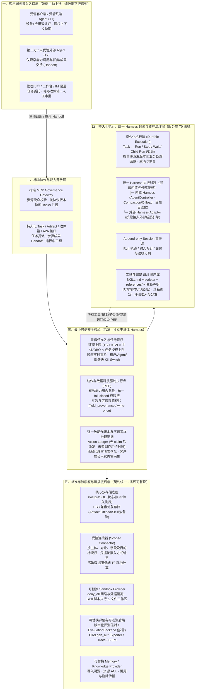

# Hecate 企业 Agent 平台演进方案

> 本文是 Hecate 平台演进的唯一主规划文档，涵盖 **平台定位、核心准则、整体架构与全栈历史包袱清理（代码、数据结构、文档）、演进里程碑，以及按独立可交付 Worktree Task 组织的删除/修改/新增实施规划**。

---

## 一、定位

### 1. 核心定位

随着基础大模型推理能力与单机 Agent Harness 的快速成熟，单纯提供底层的“模型调用与单轮工具循环”正在成为通用基础能力。但在企业生产环境中，AI 要从“孤立的对话辅助工具”走向“深度参与业务过程的智能体体系”，面临着四个本质且普适的结构性需求：

1. **非确定性推理与确定性企业治理的结合**：模型决策具有概率性与脆弱性，而企业资源访问、状态变更与数据流转必须受控、可验证、可追溯。
2. **瞬时交互会话与长周期业务任务的衔接**：复杂业务往往跨越长周期、多专业角色与多个执行环境（包括云端服务环境与员工办公终端环境），需要统一的任务生命周期与状态恢复机制。
3. **散落经验向组织级可复用资产的沉淀**：提示词、操作规程、确定性脚本与工具连接需要标准化封装、评测准入与版本化分发，使个体探索能够转化为受治理的组织能力。
4. **演进敏捷性与架构中立性的平衡**：模型、Harness 与外围观测/评估工具迭代极快，企业需要一套不被单一厂商或固定重型框架锁死的控制与运行底座。

据此，Hecate 的目标定位为：

> **可自托管、模型与 Harness 中立的“企业级 Agent 统一控制面与可信运行基础设施（Enterprise Agent Control Plane & Trusted Runtime Infrastructure）”**。

平台围绕以下 **四个通用核心命题** 构建能力：

1. **可信动作与数据安全边界**：
   - 对经 Hecate 访问的企业资源与动作，在连接器、凭据代理与资源出口实施身份、作用域、参数与来源校验，将智能决策层与真实执行权物理隔离；第三方桌面助手自行读取的本地文件、使用的模型和自带工具由其宿主治理。
2. **持久化执行与跨环境协同编排**：
   - 固定业务流程由企业开发者用显式的**版本化业务处理函数**定义分支、顺序与完成条件；需要自主模型判断的步骤通过**统一的 Harness 执行封装接口**调用（对调用者屏蔽底层究竟是**内置 Harness** 还是**外部 Harness**）；运行实例（`Run`）、步骤进度（`Step`）、持久等待（`Wait`）、跨 Agent 委派（`Delegation / Child Run`）与故障恢复统一交由**持久化执行层（Durable Execution）**管理，外部写入经受控连接器执行。
   - 统一管理长程业务任务（`Task`）的创建、分步推进、跨角色委派（内部 Agent 或外部 A2A Agent）、持久挂起等待（人工审批、信息补充、端侧协同步骤）、跨端成果交接（Handoff）与故障恢复，自然支撑云端与办公终端的端云受控协同。
3. **工具、受控连接器与完整 Skill 资产治理**：
   - 统一治理企业工具（Tools / MCP）、业务系统受控连接器（Scoped Connectors），以及由 **`SKILL.md` 指令、可执行脚本（`scripts/`）、参考资料（`references/`）与环境依赖声明共同组成的完整 Skill 资产包**——提供注册准入、隔离沙箱执行绑定、风险分级与版本管理，并在实测验证跨人复用价值后支撑从个体实践向组织资产的转化。
4. **可插拔的持续评估、可观测性与运行治理**：
   - 定义标准化的评测结果信封、发布质量门禁与不可采样治理审计契约；支持按需插拔评估执行后端与可观测性后端（OTel `gen_ai.*` / SIEM），持续度量安全性、任务交付质量与资源成本，并为内置 Harness 的**受控自进化**提供可验证的评测依据。

### 2. 核心差异化优势

1. **决策与执行物理隔离的工程级确定性安全**：以有效能力组合校验（`Rule of Two`）、隔离沙箱、窄能力工具和“先登记意图（claim）后派发、崩溃后未知副作用可对账”的 `Action Ledger` 为核心，替代脆弱的纯 Prompt 护栏或令人麻木的高频审批弹窗。
2. **统一 Harness 执行封装与代码化持久化执行**：通过统一封装层向调用者屏蔽**内置 Harness** 与**外部 Harness** 的实现差异；内置 Harness 开箱即用并支持面向真实运行反馈的**受控自进化**，确定性业务流程由显式版本化处理函数定义分支与完成条件，结合持久化执行层（`Durable Execution`）管理 `Run / Step / Wait / Child Run`，彻底消除重型图引擎与控制器双轨并存的复杂度。
3. **兼顾云端治理与端云协同演进的开放架构**：既提供可演进的内置 Harness，又通过标准 MCP Governance Gateway 与 Task/Artifact Handoff 接口，允许外部成熟 Harness 及办公终端助手在不牺牲企业数据控制权的前提下安全接入协同。
4. **私有化、数据不出域与精简双存储底座**：面向自托管与高合规要求场景，企业自主掌握全部身份、凭据、任务、资产与审计真源；开发或纯结构化模式仅依赖 `PostgreSQL` 即可冷启动，标准企业生产底座由 **`PostgreSQL`（结构化状态、账本与持久化执行）+ `S3 兼容对象存储`（如 MinIO 或企业 S3，承载 Artifact 交付产物、大结果 Offload、Skill 资产包归档、知识原件与审计备份）** 构成，不强制绑架向量库或外部工作流引擎集群等重型中间件。
5. **按业务动作验证外部系统接入边界**：首次接入外部业务系统时逐项核实业务主体、可操作的对象与字段、下游幂等及回执查询能力，据此确定可自动执行的范围；仅当具名存量系统确需共享账号时，才实施受控服务账号作用域适配。

---

## 二、核心准则

### 1. 工程与演进准则

- **极简起步，实测驱动复杂度（Start Simple, Earn Complexity）**：**先用最简单的方案在真实任务上跑起来，用沙箱、窄工具和静态结构约束替代层层人工审批弹窗，只在真实任务与对抗实测证明确有必要时才增加系统复杂度。**
- **按目标架构无包袱重构**：平台尚无正式生产客户使用，不存在存量数据割接负担，开发库可直接重建。仅为目标架构契约保留代码、表结构与文档；清理历史包袱时核对仓内实际调用关系，确保主应用正常启动、保留的独立包可干净导入。
- **区分内置与外部 Harness，通过统一封装屏蔽差异（Build for the next model）**：
  - **对调用者透明的统一封装**：业务处理函数与编排层只依赖统一的 Harness 执行封装接口，不感知底层是内置 Harness 还是外部 Harness；
  - **内置 Harness 支持受控自进化**：内置 Harness 从简洁可靠的核心起步，并支持基于运行轨迹、失败归因与评测反馈生成指令、上下文策略或 Skill 候选更新——所有自进化产物必须经版本化评测门禁与安全审核发布，严禁静默绕过门禁改写运行态或自我提权；
  - **微观确定性走 Skill 脚本与连接器，宏观长程流程走版本化处理函数与持久化执行层**：固定规则封装为完整 Skill 包或连接器代码，长程分支与跨角色协调用版本化业务处理函数 + `Durable Execution`（`Run / Step / Wait / Child Run`）承载；通用可视化节点画布与 Graph DSL 随 Pregel 图执行栈一并退役。
- **区分推理上下文恢复与外部业务写入**：Session 支持在新回合采用更新后的提示词与上下文压缩策略，但已提交决策仍按原始摘要与绑定校验恢复；`Action Ledger` 记录稳定业务键、参数摘要与回执，同键改参直接拒绝；下游支持幂等时复用原键，否则派发后结果不明即挂起，由有权主体查询或人工对账（仅凭本地账本无法推断下游是否已写入）。
- **安全性与可用性同表考核（Eval-Driven）**：真实任务样本与提示注入对抗样本必须在同一份评测报告中同时考核**任务完成率、攻击拦截率、人工审批/接管触发次数、延迟与可核实的真实货币成本**。

### 2. 安全架构四条不变量（Security Invariants）

无论未来更换何种 Harness、模型、评估/观测后端或接入何种外部客户端，以下四条系统级安全不变量不可破坏：

1. **智能决策权与真实执行权物理分离（Minimal TCB）**：LLM、Harness、Skill 包、外部输入与内部检索内容均属于**非可信决策输入**，无权自行授予权限或降低保护级别。Harness 内部的进程内 Hook 仅作为快速失败（Fast-fail）体验优化；真正的**策略强制执行点（PEP）**必须位于进程与网络隔离边界之外的受控连接器、动作网关与沙箱边界上。
2. **按有效能力组合约束自主执行（Rule of Two）**：发布、装配以及运行期动态加载 Skill、发起子委派或消费共享产物时，核对当前自主步骤能否同时接触“① 不可信输入 + ② 私有数据或敏感系统 + ③ 修改状态或对外通信”（参考 [Practical AI Agent Security](https://ai.meta.com/blog/practical-ai-agent-security/)）。三者俱全的无人监督步骤须拆分并隔离上下文，或交由独立校验具体动作的受控流程。企业硬禁令（人工审批不可覆盖）与任务授权上限（超限直接拒绝，不生成审批单）在每次派发前生效；窄工具返回的业务结论仍须按具体对象与接收方独立授权。
3. **数据读取权不等于数据释放权（数据就地计算下推）**：允许读取高敏数据不代表允许将其原始记录发往外部模型、回传未受管终端或写入共享记忆。高敏原始数据优先在服务端受控围栏（`T0`）内由确定性代码或受限步骤消化，对外仅释放最小必要结论。跨任务或 Artifact 交接保留上游访问范围约束（`source_scopes`）与不可信来源标记（`untrusted_data`）。
4. **持久恢复服从当前实时授权，且撤权不掩盖未知外部副作用**：每次从持久化等待唤醒及派发真实动作前，必须实时重验发起人存活、角色撤权与授权有效期，严禁凭旧快照继续越权执行；**当权限撤销与“崩溃前已领取（claimed）但结果未知的外部写动作”同时发生时，撤权立即阻断一切未派发新动作，但已 claimed 的未知动作必须优先暴露 `pending_reconciliation` 对账告警，严禁因撤权静默标败而掩盖已发生的外部副作用**。

---

## 三、整体架构、模块划分与全栈历史包袱重整

### 1. 整体目标架构

平台**统一掌握**的是：**零信任身份与安全策略、持久化执行（`Durable Execution`）与业务任务契约、统一 Harness 调用封装、受控动作与数据释放边界、工具与完整 Skill 资产准入规范、以及治理审计与发布评测门禁契约**；
平台**保持独立与可插拔替换**的是：**具体 Harness 实现（内置 Harness / 外部 Harness）、模型供应商、接入客户端形态、对象存储实现（S3 / MinIO / 本地文件）、记忆与知识检索后端（`MemoryProvider` / `KnowledgeProvider`）、评估执行后端（`EvaluationBackend`）、隔离沙箱后端（`SandboxProvider`）、以及可观测性后端（`Observability / OTel & SIEM Backend`）**。

#### 核心持久化术语约定（对齐业界 Durable Execution 惯例）

为避免业务概念与底层执行原语混淆，全仓统一采用以下标准术语：

| 术语 | 含义与职责边界 |
|---|---|
| **`Task`（业务任务）** | 顶层业务委托单元，拥有责任人、业务目标、交付产物引用与验收结论 |
| **`Run`（运行实例）** | 某次 `Task` 的具体执行尝试（失败重试或跨版本重跑生成新 `Run`，历史 `Run` 绑定冻结版本） |
| **`Step`（执行步骤）** | `Run` 中由版本化业务处理函数或 Harness 推进的单个阶段/决策回合 |
| **`Wait / Resume`（持久等待与恢复）** | 释放 Worker 资源的持久化挂起状态（含人工审批、补件输入、计时器、端侧协同步骤）及唤醒续跑 |
| **`Child Run / Delegation`（委派子执行）** | 由父 `Run` 发起、具备独立权限交集与预算切片的跨角色或跨 Agent（含 A2A）受控子执行 |

#### 跨环境协同边界与执行环境准入等级（`T0 / T1 / T2`）

- **桌面端协同边界与单向控制铁律**：Hecate 负责客户端从办公入口提交材料、服务端持久化接手、运行中补件及结果回流原任务，优先复用现有桌面助手、邮件插件或 Web 门户（仅在试点证实必须访问本机文件或本地传统客户端时，才按需提供可选轻量组件，不将独立个人桌面产品与企业控制面强绑）。企业邮箱或业务系统已有原件时优先交接受授权版本引用，仅在本机的材料由用户选定后提交。跨端默认采用**客户端主动上行调用（Edge-Initiated）+ 服务端收件箱通知**；服务端下行响应严格限制为**纯数据与状态信封（Data-only Envelope，严禁携带可执行脚本或本地命令指令）**，且服务端不采集客户端个人闲聊或私人记忆；终端离线时释放等待资源，服务端继续推进无须补件的步骤。
- **离散环境准入等级（由服务端可信凭据签发，禁止客户端自报）**：
  - `T0（企业受控服务端）`：可承载长程无人值守任务；隔离沙箱中的模型与 Skill 脚本仍属非可信执行者，仅通过受控接口访问本次任务获准的数据，长期凭据由代理持有。
  - `T1（受管终端与认证客户端）`：同时通过**受管设备证明 + 获批客户端应用身份认证**，允许在授权范围与受控出口下开展多轮交互协同。
  - `T2（未受管终端或无法验证数据出口的第三方客户端）`：默认拒绝向其释放非公开敏感原始数据，仅开放窄能力结论查询与任务/成果 Handoff 接口。

---

### 2. 全栈历史包袱审视与重构总表（代码、数据结构、文档）

由于当前系统尚未投产、**无存量生产数据割接负担**，我们以目标架构为唯一准绳，对代码模块、数据库 Schema 与文档体系中的历史包袱实施彻底重整：

#### （1）移除 Pregel 图执行栈、Graph DSL 与可视化画布
固定流程由显式**版本化业务处理函数**表达分支、顺序与异常处理；涉及暂停、跨进程恢复或委派时，由持久化执行层（`Durable Execution`）管理 `Run / Step / Wait / Child Run`；需要模型判断的步骤调用统一的 Harness 执行封装接口；脚本中的外部写入同样经受控连接器与 `Action Ledger`。例如，对于需要规则核验、人工审批与下游写入的标准业务流程：处理函数在部署时绑定任务类型与版本；请求到达后函数判定是否申请审批，进入等待时持久化版本、待批提案并释放 Worker；审批回执到达后平台重验审批人、提案与当前授权，按任务绑定的原版本唤醒函数决定结束或派发写入。独立图引擎、图编译器与通用拖拽画布引入了第二套流程定义与执行状态，因此在 `M1-T2` 彻底物理删除（改动入口见 [现行装配](../../packages/hecate-runtime/src/hecate_runtime/execution_assembly.py) 与 [现行 Workflow 服务](../../src/hecate/studio/workflows/execution_service.py)）。

#### （2）统一存储底座（PostgreSQL + S3 兼容对象存储）、移除 SQLite 生产支持与重建迁移基线
- **结构化状态与迁移基线**：逐项核对 `Task`、`Run`、审批、预算、事件与动作账本的权威写入方、唯一键、事务边界与投影消费者；消除平台表（`src/hecate/models/`）与 Durable 表（`packages/hecate-durable`）对同一事实的双套重复写入，保留有交付或恢复用途的 outbox 与投影，物理删除已退役功能对应的僵尸 ORM 表。**正式删除 SQLite 生产持久化支持与双库生产矩阵**，生产结构化存储唯一指定 PostgreSQL；待保留模型稳定且最后一个旧模型消费者退出后，清空历史增量 Alembic 迁移脚本，重建单一干净的 `001_initial_schema.py` 基线迁移，并在空 PostgreSQL 验证 `alembic upgrade head`。
- **对象存储边界（S3 / MinIO）**：明确对象存储为标准企业生产底座的另一半——通过统一 `ObjectStorage` 抽象接口对接 S3 兼容存储（生产使用企业 S3 或自托管 MinIO，开发与单机最小启动模式支持本地文件系统/内存降级），统一承载 **Artifact 交付产物、大工具结果 Offload、完整 Skill 资产包归档、知识原件与审计/系统备份**，避免大体积二进制或上下文内容撑爆 PostgreSQL。
- **测试基础设施全面提速**：非跨进程单元/组件测试统一使用共享 Schema 缓存的 `sqlite+aiosqlite:///:memory:` 内存数据库、内存对象存储替身与契约等价的内存持久化替身（In-Memory Seam），消除磁盘临时 `.db` 文件 I/O；多进程锁争用、租约抢占、唯一约束竞争与备份恢复使用真实 PostgreSQL 集成测试档。

#### （3）清理 `docs/` 与 `openspec/` 文档历史包袱
主规划聚焦目标边界、核心架构与可执行 Task 门禁。随功能退役同步物理清理已废弃架构（Graph/Pregel、Visual Canvas、Ontology、Agentic RL、遗留无门禁自优化、离线 Runner wheelhouse）对应的过时设计文档与旧 ADR、清理历史过程归档（`openspec/changes/archive/`）与早期大而全的功能目录（`docs/features/feature-inventory.yaml` 及生成校验脚本，先确保现行导航替代入口可达再同步移除 CI 作业），仅保留仍被现行测试、安全与恢复契约引用的核心决策与验收证据。

#### （4）代码库各模块具体重构总表（基于真实包依赖核查）

| 模块 / 路径 | 目标架构职责 | 摆脱历史包袱的重构动作（Delete / Merge / Refactor） |
|---|---|---|
| `packages/hecate-runtime` | **内置 Harness 与统一执行封装**：统一 Harness 调用封装接口、内置 `AgentController` & `AgentHarness`（Compaction / Offload / 演进与自进化扩展钩子）、`ToolCallExecutor`、`Action Ledger` 接口、`RuntimePort` | **1. 物理删除 `src/hecate/runtime/` 全部转发 shim 文件**（仓内调用方批量迁移为直接导入 `hecate_runtime`，保持包可独立安装） **2. 物理删除 Pregel 图引擎、图编译器、Channel、优化 Pass、图专属 Worker 与图回放模块** **3. 抽离对调用者透明的 Harness 封装接口，解耦新回合上下文与已决回合恢复，打通 Compaction / Offload** |
| `packages/hecate-durable`、`src/hecate/models/`、`alembic/` | **权威持久化执行状态、投影与高速内存测试底座** | **1. 删除 SQLite 生产支持**，生产结构化存储唯一指定 PostgreSQL **2. 删除僵尸 ORM 表并消除平台/Durable 重复写入**，清空历史增量 Alembic 迁移并重置为单一干净基线 **3. 推广内存数据库（`sqlite+aiosqlite:///:memory:`）与内存契约替身加速单元/组件测试** |
| `src/hecate/execution/` | **持久化执行（`Durable Execution`）与协同控制面**：Deployment、`Task`、`Run`、`Step`、版本化业务处理函数派发、`Wait / Resume`、`Child Run`（委派）、Kill Switch 与 REST 收件箱 | 收敛聊天与 REST 入口至统一 `EntryExecutionService`；拆薄巨型 `task_dispatcher.py`；将定时/事件触发（`ops/scheduling/`）收拢至执行层 |
| `packages/hecate-governance`、`src/hecate/enterprise/`、`packages/hecate-enterprise` | **零信任身份、环境准入与安全治理层**：用户/Agent/Sponsor 身份、IdP 与 OBO 委派、`T0/T1/T2` 准入、凭据管理、输出与数据释放治理 | **保留零主应用依赖的 `hecate-governance`**（保住独立消费方）与承载可选重型 SSO/Vault SDK 的插件包 `hecate-enterprise`；将错放在 `src/hecate/ops/dlp` 和 `output_security` 的运行时安全检查迁入治理层并在组合根注入 `hecate-runtime`，**彻底根除 `hecate-runtime → hecate.ops` 反向依赖** |
| `src/hecate/tools/` | **强制执行点（PEP）、受控连接器、MCP 治理网关与完整 Skill 资产库**：`gateway/`、`policy/`、`mcp/`、`skill*`（`SKILL.md` + `scripts/` + `references/` + 依赖） | 强化 `gateway/` 为进程/网络级 PEP；完整支持含可执行脚本的 Skill 资产包（包体存入 `ObjectStorage`）、沙箱绑定与三级风险分级；打通标准 MCP Governance Gateway |
| `src/hecate/studio/`、`web/` | **纯净的 Agent 与 Skill 定义、评测、发布门禁与受控演进入口** | **物理删除**可视化画布与图 DSL（`studio/workflows/`、`web/src/components/workflow/`）、`intent_packages/`、`meta_agents/`、`suggestions/` 及重复闲置状态目录；清理早期与旧图结构耦合、缺乏评测门禁的遗留 `self_evolution/` 实现（在 M4 基于统一评测与审批门禁重建内置 Harness 受控自进化闭环）；在 `agent_versions` 新增 `Rule of Two` 发布门禁 |
| `src/hecate/ops/`（吸收 `packages/hecate-ops`） | **不可采样治理审计、发布评测门禁、统一 `ObjectStorage` 备份/归档、可观测性与配额** | **合并存在循环依赖的假拆包 `packages/hecate-ops` 回 `src/hecate/ops/`**；**物理删除**遗留的 `prompt_optimization/` 与 `synthesis/`；收口 S3/MinIO 对象存储适配层供 Artifact/Offload/Skill包/备份共用；统一发布评测结果信封并对齐 OTel `gen_ai.*` |
| `packages/hecate-sandbox`、`hecate-llm`、`hecate-memory` | **可替换基础 Provider 包**：隔离沙箱（代码与 Skill 脚本执行）、多模型调用适配、可选记忆/知识检索 | **物理删除 `hecate-llm/hub/fine_tuning.py`**；加固 `hecate-sandbox` 的 `deny_all` 网络与凭据隔离；补齐 `hecate-memory` 写入来源溯源与 ACL |
| `packages/hecate-runner` | **可选轻量执行节点** | 冻结扩展；按实际受管投递需求盘点后，删除冗余的离线 wheelhouse 安装器、原子指针冷切换与本地 SQLite 生产持久化路径 |
| `docs/`、`openspec/` | **精简、与现行代码一致的文档与决策证据** | 随功能退役同步清理过时设计文档、旧 ADR、早期大而全 Feature 清单生成器及历史归档目录，保留仍被现行测试与安全契约引用的核心决策证据 |

---

## 四、演进里程碑

M1 删除独立图执行栈与全栈历史包袱、重建干净的数据基线与内存测试底座，同时用授权样本验证端云交接与跨人 Skill 复用；M2 完善统一 Harness 封装、内置 Harness 长程恢复、持久化执行（`Durable Execution`）与治理；M3 验证 `PostgreSQL + S3/MinIO` 参考生产部署与强制治理边界；M4 将动作治理层外溢为标准 MCP 网关、打通跨环境协同，并按试点证据落地组织级 Skill 分发与内置 Harness 的受控自进化闭环。

| 里程碑 | 核心目标 | 关键交付物 | 退出门槛（Acceptance Gates） |
|---|---|---|---|
| **M1：全栈历史包袱出清、基线重建与真实任务评测** | 无包袱清理图执行栈、废弃模块、冗余表/旧迁移与过时文档，建立内存高速测试底座，并用授权样本验证端云交接与跨人复用 | 1. 物理删除废弃外围模块、Pregel 图栈/画布与 `src/hecate/runtime/` 转发 shim，合并 `hecate-ops` 并根除反向依赖 2. 删除 SQLite 生产支持，合并冗余表并重建单一 PG 基线迁移，建立内存数据库/内存对象存储高速测试底座 3. 清理过时 `docs/` / `openspec/` 文档与失效清单门禁 4. 授权真实样本与成对注入对抗变体、跨人复用对照试验、任务授权上限与零明文凭据加固、可控服务 S05 对账基线 | 1. 移除图模块与 shim 后主应用与内核包均可干净导入启动，保留入口参考任务全绿，`mypy`/`ruff` 零错误 2. 单元与组件测试切换内存底座后本地与 CI 耗时显著下降，空 PG 通过新基线 `alembic upgrade head` 3. 真实样本与对抗变体产出五维基线报告（**完成率、拦截率、审批次数、延迟、真实成本**）及跨人复用对照结论；可控服务模拟写入失联后正确挂起 `pending_reconciliation` 且零盲目重发；运行态数据零明文凭据 100% 通过 |
| **M2：统一 Harness 封装、持久化执行编排、单一权限链与完整 Skill 门禁** | 抽象对调用者透明的 Harness 执行封装，解耦内置 Harness 恢复与 Compaction/Offload，落地持久化执行层、单一权限链与动态 `Rule of Two` 门禁 | 1. **统一 Harness 执行封装接口**（对业务层屏蔽内置与外部 Harness 差异）；内置 Harness 已接受决策按原摘要恢复，新回合打通 `Compaction` 与基于 `ObjectStorage` 的 `Offload` 2. **统一持久化执行层（`Durable Execution`）**：管理 `Task → Run / Step / Wait / Child Run`，支持版本化业务处理函数派发与定时/事件触发，拆薄 `task_dispatcher.py` 并收口聊天/REST 入口（G3） 3. 单一确定性 Hook + 固定优先级权限链，以及租户/Agent/部署级 **Kill Switch** 4. **完整 Skill 资产包（`SKILL.md` + `scripts/` + 资源/依赖）** 对象存储归档、沙箱绑定、风险分级与静态+动态 **`Rule of Two` 有效能力组合门禁** | 1. 业务处理函数仅通过统一封装接口调用 Harness；开启 Compaction/Offload 的长程任务跨重启正常恢复，提示词/压缩策略微调不阻断恢复，外部写动作零重放 2. 版本化业务处理函数可独立于模型运行并在审批重启后按绑定原版本续办；G3 多入口一致性测试全绿 3. 含脚本 Skill 在隔离沙箱受控运行；静态或动态凑齐三要素的无人监督步骤被拦截；Kill Switch 立即阻断在途新动作并返回真实回执 |
| **M3：PG + S3 生产强制治理、通用受控连接器、可插拔评估/观测与符合性** | 固化独立于 Harness 的最小 TCB 强制执行点、通用连接器契约与可替换评估/观测契约，完成 `PostgreSQL + S3 兼容对象存储` 参考生产符合性验证 | 1. 进程/网络级不可旁路 PEP、凭据代理与通用受控连接器契约（含服务端 `T0` 窄能力计算下推） 2. 唤醒实时权限重验与“撤权阻断新动作、保留已 claimed 未知副作用对账告警”状态机闭环（G1/G2） 3. 企业 IdP Agent 身份与责任人撤权联动、终端 AI 身份披露 4. **版本化评测结果信封与 OTel `gen_ai.*` 观测导出契约**（与不可采样治理审计分离；外部 `EvaluationBackend` 按具名需求提取） 5. `PostgreSQL + S3/MinIO` 跨进程故障恢复、一致性备份对账与多租户配额实测 | 1. Runtime/Skill 脚本/Sandbox 直连受保护资源被 100% 拒绝；超出对象/字段/目的地授权的调用被拦截 2. PG 跨进程演练通过“外部写成功→回执前崩溃→恢复时用户撤权”竞态，准确暴露 `pending_reconciliation` 告警 3. 停用 OTel 后治理审计仍完整可查，缺有效评测证据时暂停新发布；逐项通过 S01–S07（S08 随首个具名共享账号连接器验收，未启用时记不适用） |
| **M4：动作治理外溢、跨环境协同、组织级 Skill 分发与内置 Harness 受控自进化** | 将动作治理层外溢为标准 MCP 网关，跑通跨环境与外部 Harness 协同，按试点证据启用组织级 Skill 分发与内置 Harness 受控自进化闭环 | 1. 标准 **MCP Governance Gateway**（资源受众校验、企业授权、按协议版本协商 Tasks 扩展并兼容普通工具提交） 2. **跨环境任务协同与外部 Harness 适配闭环**：客户端主动上行 + 纯数据下行信封、`T0/T1/T2` 环境准入校验、A2A/MCP 跨 Agent 委派与出站白名单，以及通过统一 Harness 封装接入外部 Harness 的验证 3. 按试点证据交付组织级 Skill 分发与**内置 Harness 受控自进化闭环**（失败轨迹归因 → 候选指令/策略/Skill 提案 → 版本化评测门禁与人工审批发布） | 1. 外部成熟客户端/Harness（声明 Tasks 扩展与仅普通工具调用双路径）通过 Hecate MCP Gateway 完成受控读写、窄能力调用、审批拦截与审计闭环 2. “端侧协同步骤 ↔ 服务端多角色 `Child Run` 编排 ↔ 受控连接器写入 ↔ 收件箱反馈”全链路跑通，`T2` 客户端零机密原表泄露（S09） 3. 启用 M4-T3 时验收跨人复用、责任人交接、自进化候选经评测审批发布与一键回滚，确保零静默自修改与零自提权 |

### 核心安全与生产反例验收基线（S01–S09）

| 编号 | 验收场景 | 对应不变量 | 强制执行点（PEP） | 门禁阶段 |
|---|---|---|---|---|
| **S01** | 同一笔业务分别使用正常与夹带越权请求的输入，拒绝额外动作后仍可继续合法步骤 | 不变量 1 & 2 | 任务授权上限、资源侧 PEP 与动作回执 | M1 / M2 |
| **S02** | 静态工具、动态 Skill、子委派或共享产物使同一自主步骤同时接触不可信输入与私有数据，并能外发或写状态 | 不变量 2 | 发布、装配、动态能力变更及资源侧 PEP | M2 |
| **S03** | Harness、Skill 脚本或 Sandbox 内代码尝试绕过受控网关直连业务库、Memory 或外网 | 不变量 1 & 3 | Sandbox `deny_all` 网络隔离 + 受控连接器网关 | M2 / M3 |
| **S04** | 任务在挂起等待期间发起人离职/撤权，唤醒后尝试继续执行后续步骤或使用旧租约 | 不变量 4 | `task_control` 唤醒重验 + 派发前实时权限检查 | M2 / M3 |
| **S05** | M1 用可控服务使写入生效后丢失回执，核对未决状态与派发次数；M3 加入 PG 跨进程崩溃、接管与发起人撤权，验证对账仍可见 | 不变量 4 | `Action Ledger`、派发前授权重验与对账视图 | M1 基线 / M3 故障演练 |
| **S06** | 审批通过后参数被篡改、重放已消费审批，或企图用人工审批覆盖企业硬禁外发红线 | 不变量 2 & 3 | 审批参数摘要 CAS 绑定 + Hard Deny 最高优先级 | M2 / M3 |
| **S07** | Checkpoint、EventStore、Trace 或日志中检出明文凭据，或跨租户/跨作用域越权读取衍生 Artifact | 不变量 3 & 4 | 凭据代理引用化 + `source_scopes` 归属校验 | M1 / M3 |
| **S08** | 面向确需共享高权限账号的存量系统，调用者尝试查询非授权作用域数据或拉取全量机密原表 | 不变量 1 & 3 | 服务端 `Scoped Connector` 参数强制注入 + `T0` 窄能力封装 | 按需：首个共享账号连接器启用前 |
| **S09** | 外部或未受管客户端（`T2`）伪造 `T0/T1` 准入标签、请求非公开敏感原表，或下行信封夹带可执行指令 | 不变量 1 & 3 | 服务端环境凭据校验 + 数据释放边界 + 纯数据下行 Schema | M4 |

---

## 五、里程碑规划（按独立可运行 Worktree Task 组织的删除、修改、新增方案）

### 全局任务跟踪

每个 Task 在表中占一行，覆盖 M1 至 M4。任务小节定义范围、依赖和验收标准。发现已合入的子 PR、正在进行的工作或新增验收证据时，更新对应行的状态和证据。整项达到退出标准后，将状态改为「已完成」并把 ☐ 改为 ☑。尚无可靠状态证据时填「待核实」。

推荐下一项时按表中顺序筛选具备开工条件的未完成事项。用户指定优先级时按用户要求处理；依赖某个子交付或试点证据时，按对应任务小节核实具体条件。

| 完成 | 任务 | 状态 | 前置依赖 | 进展与验收证据 |
| --- | --- | --- | --- | --- |
| ☐ | M1-T1 · 退役遗留外围模块 | 部分完成 | 无 | 旧 Prompt 自动优化已随 [#418](https://github.com/xueyufish/hecate/pull/418) 退役，其余范围待核实 |
| ☐ | M1-T2 · 退役图执行栈、画布与 runtime shim | 等待前置 | M1-T1 | — |
| ☐ | M1-T3 · 收敛数据模型与 PostgreSQL 迁移基线 | 等待前置 | M1-T1、M1-T2 | 最后一个旧模型消费者退出后重建基线 |
| ☐ | M1-T4 · 清理过时文档与失效门禁 | 待核实 | 随 M1-T1 至 M1-T3 同步推进 | 按已退役范围分批清理，随退役工作收尾 |
| ☐ | M1-T5 · 真实任务评测与凭据加固 | 未开始 | 无 | 已有可复用的技术基线，整项交付尚未启动 |
| ☐ | M2-T1 · 统一 Harness 封装与长程恢复 | 等待前置 | M1-T2、M1-T3 的 ObjectStorage 抽象 | — |
| ☐ | M2-T2 · 统一持久化执行层与入口 | 等待前置 | M1-T2 的无图入口、M1-T3 的事实归属、M1-T5 的业务基线 | — |
| ☐ | M2-T3 · 收敛动作权限链 | 等待前置 | M1-T5 | — |
| ☐ | M2-T4 · 租户、Agent 与部署级紧急停止 | 待核实 | 无 | 与 M2-T3 通过撤权状态接口对接 |
| ☐ | M2-T5 · Skill 资产包与 Rule of Two 门禁 | 等待前置 | M1-T3 的 ObjectStorage 归档能力 | — |
| ☐ | M3-T1 · 强制执行点与通用连接器契约 | 等待前置 | M2-T3 | — |
| ☐ | M3-T2 · 唤醒重验与撤权对账 | 等待前置 | M2-T2 | — |
| ☐ | M3-T3 · 企业身份映射与 AI 身份披露 | 等待前置 | M1-T2 | — |
| ☐ | M3-T4 · 评测信封与 OTel 观测契约 | 等待前置 | M1-T2 | — |
| ☐ | M3-T5 · PostgreSQL 与 S3 生产符合性 | 等待前置 | M3-T1、M3-T2 | — |
| ☐ | M4-T1 · MCP 治理网关 | 等待前置 | M3-T1 | — |
| ☐ | M4-T2 · 跨环境协同与外部 Harness 接入 | 等待前置 | M2-T1、M2-T2、M3-T2、M3-T3 | — |
| ☐ | M4-T3 · 组织级 Skill 分发与受控自进化 | 等待前置 | M2-T1、M2-T5、M3-T4 | 启动还需跨人复用达标，以及经脱敏与人工复核的真实失败样本和迭代痛点 |

### Task 粒度与独立性设计说明

本节中的每一个 **Task（如 `M1-T1`）均对齐 `hecate-parallel-plan` 规范，定义为“可在单个独立 Git Worktree 中由一名开发者或实现 Agent 端到端独立完成、独立测试并作为聚焦 PR 合入的工作包（One PR, One Purpose）”**。当单个 Task 涉及多个独立删除对象或共享 Schema 变更时，按可独立验证的目的拆分逻辑 PR；并行前须核对活跃工作树、共享热点文件与迁移基线。所列 `pytest` 命令为局部快速回归入口，真实模型、PostgreSQL 跨进程、网络隔离与外部客户端互操作均须另附实测证据，缺配置跳过的场景如实标记为待验。

---

### M1 规划：全栈历史包袱出清、基线重建与真实任务评测

> **并行度**：`M1-T1`（废弃外围模块清理）与 `M1-T5`（真实任务/对抗基线与零明文凭据加固）可立即并行启动；`M1-T2`（Pregel 图栈与 runtime shim 清理、合并 `hecate-ops`）可随后推进；`M1-T3`（Schema 收敛、SQLite 生产移除、重建迁移基线与内存测试底座）在旧模型消费者退出后落盘；`M1-T4`（文档与失效门禁清理）随退役同步推进。

#### Task M1-T1：物理退役遗留无门禁外围模块与多余路由
- **前置依赖**：无（可立即启动）
- **模块所有权（Hotspot）**：`src/hecate/studio/`（废弃子目录）、`src/hecate/ops/`（废弃子目录）、`packages/hecate-llm/src/hecate_llm/hub/`、[src/hecate/main.py](../../src/hecate/main.py)
- **删除（Delete）**：
  - 按模块核对 API、前端入口、后台调度、作业与数据依赖后，**物理删除**早期与旧图引擎耦合或缺乏统一评测审批门禁的遗留外围模块及其路由与测试：
    - `src/hecate/ops/prompt_optimization/` 及 `api/prompt_optimization.py`（遗留 Prompt 自动优化）；
    - `src/hecate/studio/self_evolution/` 及 `api/self_evolution.py`（遗留无统一门禁的旧自演化管道；内置 Harness 的受控自进化在 M4 基于统一评测与发布门禁重建）；
    - `src/hecate/ops/api/synthesis.py` 及数据集合成作业；
    - `packages/hecate-llm/src/hecate_llm/hub/fine_tuning.py`（微调作业管理）；
    - `src/hecate/studio/intent_packages/`、`studio/meta_agents/`、`studio/suggestions/` 及无消费的重复状态目录。
  - 从 [src/hecate/main.py](../../src/hecate/main.py) 与 `src/hecate/core/composition/wiring.py` 中移除上述模块的路由挂载与启动初始化。
- **修改（Modify）**：
  - 停用旧演化与合成调度时，保留仍被消费的合规清理作业、基础样本/评测核心路径、手工 Skill 发布与回滚能力。
  - 盘点 `packages/hecate-runner/` 依赖，冻结其扩展并在确认无生产消费者后退役离线 wheelhouse 安装器与冷切换脚本（保留受管投递所需的最小契约注册与回执）。
- **新增（Add）**：
  - 新增主应用最小核心 Profile 冷启动与 OpenAPI 路由契约回归测试。
- **独立验证命令**：`python -m pytest tests/test_api/ tests/test_core/ -q`

#### Task M1-T2：删除 Pregel 图执行栈、可视化画布与 `runtime` 转发 Shim，收敛分裂包与反向依赖
- **前置依赖**：`M1-T1`（避免与废弃模块同时改动 `main.py`）
- **模块所有权（Hotspot）**：`packages/hecate-runtime/`、`src/hecate/runtime/`、`src/hecate/studio/workflows/`、`web/src/components/workflow/`、`packages/hecate-ops/`、`src/hecate/ops/dlp/`、`src/hecate/ops/output_security/`
- **删除（Delete）**：
  - **物理删除** Pregel 图执行栈、Graph DSL、图编译器、图装配（[execution_assembly.py](../../packages/hecate-runtime/src/hecate_runtime/execution_assembly.py) 中的图分支）、图专属 Worker、图回放（`replay/`）、Studio 图工作流服务（[execution_service.py](../../src/hecate/studio/workflows/execution_service.py)）、前端可视化画布（`web/src/components/workflow/`）及对应 API、模板与专属测试。
  - **物理删除** `src/hecate/runtime/` 下全部空壳兼容转发 shim 文件。
  - **消除循环假拆包 `packages/hecate-ops`**（合并回 `src/hecate/ops/`，同时保留零主应用依赖的 `packages/hecate-governance` 与承载可选 SSO/Cloud Vault SDK 的 `packages/hecate-enterprise`）。
- **修改（Modify）**：
  - 全仓将 `from hecate.runtime...` 统一替换为 `from hecate_runtime...`，并核对 chat、定时任务与子调用入口，将目标架构保留的能力接入统一 Harness 执行封装或显式业务处理函数。
  - 将错放在 `src/hecate/ops/dlp/` 与 `output_security/` 的运行时安全检查迁入治理层并在组合根注入 `hecate_runtime`，**彻底根除 `hecate-runtime → hecate.ops` 反向延迟导入**。
  - 同步更新 `pyproject.toml` 与分层守卫测试。
- **新增（Add）**：
  - 新增内核纯净度与清洁安装验证（确认无图模块与无 shim 后主应用及独立 `hecate-runtime` 包均可干净导入启动，固定流程在允许、拒绝、取消与重启场景下行为正确）。
- **独立验证命令**：`python -m pytest packages/hecate-runtime/tests/ tests/test_runtime/ tests/test_layering_domain.py -q`

#### Task M1-T3：清理僵尸表与双套写入、移除 SQLite 生产支持、重建迁移基线与内存测试底座
- **前置依赖**：`M1-T1`、`M1-T2`（在最后一个旧模型消费者退出后生成新基线）
- **模块所有权（Hotspot）**：`src/hecate/models/`、`packages/hecate-durable/`、`alembic/versions/`、`src/hecate/ops/backup/storage.py`、`tests/conftest.py`
- **删除（Delete）**：
  - **物理删除**已退役功能对应的僵尸 ORM 模型文件（`workflow.py`、`evolution.py`、`prompt_optimization.py`、`dataset_synthesis_job.py`、`fine_tuning_job.py`、`inference_endpoint.py`、`intent_package.py`、`conversation_cluster.py` 等）。
  - **正式删除 SQLite 生产持久化支持路径与双数据库生产矩阵**（生产结构化存储唯一指定 PostgreSQL）。
  - 待保留模型稳定后，**清空 `alembic/versions/` 下的历史增量迁移链**，并清理代码中已无消费者的历史表 backfill 兼容分支。
  - 清理非跨进程单元/组件测试中不必要的临时磁盘 `.db` 文件创建逻辑。
- **修改（Modify）**：
  - 逐表核对平台表与 Durable 表的业务主键、权威写入方、事务边界与投影恢复路径：消除同一事实的重复写入，保留有交付或重建价值的 outbox 与投影。
  - 抽象并统一 `ObjectStorage` 对象存储接口（统一服务于 Artifact、Offload、Skill 资产包与备份；生产对接 S3/MinIO，开发与测试支持本地文件/内存实现）。
  - 重构 `tests/conftest.py` 及持久层测试夹具：非跨进程单元/组件测试全面采用**共享 Schema 缓存的 `sqlite+aiosqlite:///:memory:` 内存数据库**、内存对象存储与契约等价的 **`InMemoryDurableSeam` 内存测试替身**以大幅提升本地与 CI 速度；多进程锁争用、租约过期、唯一约束竞争与崩溃恢复保留在真实 PostgreSQL 测试档。
- **新增（Add）**：
  - 在同一变更中基于精简收敛后的核心模型生成单一干净的 `001_initial_schema.py` 基线迁移，并在空 PostgreSQL 上验证 `alembic upgrade head`、唯一约束、应用启动与参考任务执行。
  - 新增“内存契约替身 vs PostgreSQL 存储实现”的行为等价性契约测试（并发领取、审批消费与未知副作用）。
- **独立验证命令**：`python -m pytest packages/hecate-durable/tests/ tests/test_migrations/ tests/test_models/ -q`

#### Task M1-T4：清理过时 `docs/` / `openspec/` 文档历史包袱与失效门禁
- **前置依赖**：随 `M1-T1`～`M1-T3` 退役进度同步收尾
- **模块所有权（Hotspot）**：`docs/`、`openspec/`、`scripts/feature_inventory.py`、`.github/workflows/docs-check.yml`、`README.md`
- **删除（Delete）**：
  - **物理删除**已退役架构（Graph-First/Pregel、Visual Canvas、Ontology、Agentic RL、遗留无门禁自优化、离线 Runner wheelhouse）对应的过时设计文档、操作说明与旧 ADR。
  - **清理** `openspec/changes/archive/` 历史过程归档、`docs/refactor/` 其余历史阶段性复核快照，以及早期大而全的 `docs/features/feature-inventory.yaml` 和 `scripts/feature_inventory.py` 生成/检查脚本（在现行导航与替代证据可达后同步删除）。
- **修改（Modify）**：
  - 在同一变更中更新 `.github/workflows/docs-check.yml`、`README.md` 与 `docs/design/README.md`，移除已废除的清单生成器作业，保留仍被现行测试、安全与恢复行为引用的核心决策证据。
- **新增（Add）**：
  - 梳理并补齐与新架构 1:1 对齐的精简现行核心文档索引，确保变更影响的全部本地链接零断链。
- **独立验证命令**：`python .opencode/skills/hecate-docs-sync/scripts/sync_specs.py --audit-readme --audit-offline`

#### Task M1-T5：真实任务样本、提示注入对抗五维基线与运行态数据零明文凭据加固
- **前置依赖**：无（可与 `M1-T1`～`M1-T4` 并行）
- **模块所有权（Hotspot）**：`tests/scenarios/`、`src/hecate/execution/task_registration.py`、`src/hecate/contracts/execution/`
- **删除（Delete）**：
  - 移除将合成 Stub / 固定脚本调用等同于“场景认证通过”的汇总逻辑；清理 `EventStore`、`Checkpoint`、动作账本及 Trace 写入路径中任何可能落盘明文 API Key / Token 的遗留代码。
- **修改（Modify）**：
  - 在 `task_registration.py` 与 `contracts/execution/request.py` 中固化任务级静态授权快照契约（记录 `max_grantable_scope`、`source_scopes` 与外发策略），并在持久化与 Trace 写入边界强制执行凭据引用化（仅存 `secret_ref`）。
  - 升级 `tests/scenarios/` 实验采集器接入前沿强模型与真实货币成本核算（关闭 G4 核心缺口，未知费用标未知，越权或重复副作用独立判失败）。
- **新增（Add）**：
  - **端云交接与长程交付样本**：用授权真实样本验证长程文件交付与跨端任务交接（外部写入使用可控测试服务）。选定一条参考业务任务从已有桌面助手、邮件插件或门户提交并记录 Task ID；断开终端后服务端继续推进，遇到待确认版本则挂起，重连补件后返回带测试来源的写入回执。
  - **跨人复用对照试验**：用现有 Skill Registry 固定候选版本，由原作者以外的同岗人员使用自己的权限，在相同模型、工具与验收标准下对比现行方法与候选 Skill 处理难度相近的未见案例，记录交付质量、人工耗时及求助原作者次数与原因（缺少人员或授权样本时标为待验证）。
  - **成对对抗变体与五维报告**：固定工具、权限、样本与验收人，比较人工基线与强模型多次试跑；每份正常样本配一份夹带越权请求的对抗变体，逐样本记录交付合格性、越权拒绝后能否续办、写入回执与证据来源、审批次数、接管耗时、延迟及可核实费用。
  - **S05 可控服务基线**：使不支持幂等重试的测试服务记录一次写入后中断响应，验证再次投递或恢复时下游实际写入与派发尝试均为一次，账本与任务视图准确显示 `pending_reconciliation`（标明“可控服务模拟”，与真实岗位样本验收分列）。
  - 新增 S01（任务授权上限拦截）与 S07（运行态持久化数据零明文凭据及 `source_scopes` 隔离）反例测试。
- **独立验证命令**：`python -m pytest tests/scenarios/ tests/test_execution/ -k "registration or provenance or evidence or reconciliation" -q`

---

### M2 规划：统一 Harness 封装、持久化执行编排、单一权限链与完整 Skill 包门禁

> **并行度**：`M2-T1`（统一 Harness 封装与内置 Harness Compaction/Offload）、`M2-T2`（统一持久化执行层与入口收口）、`M2-T4`（Kill Switch）、`M2-T5`（完整 Skill 包治理与动态 `Rule of Two` 门禁）按目录隔离可并行推进；`M2-T3`（单一权限链）与 `M2-T1` 在 `ToolCallExecutor` 上轻量衔接。

#### Task M2-T1：抽离统一 Harness 执行封装，解耦内置 Harness 恢复并打通 Compaction 与 Offload
- **前置依赖**：`M1-T2`、`M1-T3`（`ObjectStorage` 抽象）
- **模块所有权（Hotspot）**：[agent_controller.py](../../packages/hecate-runtime/src/hecate_runtime/agent_controller.py)、[agent_harness.py](../../packages/hecate-runtime/src/hecate_runtime/agent_harness.py)、[harness_turn.py](../../packages/hecate-runtime/src/hecate_runtime/harness_turn.py)、[decision_step.py](../../packages/hecate-runtime/src/hecate_runtime/decision_step.py)、[context_processors.py](../../packages/hecate-runtime/src/hecate_runtime/context_processors.py)
- **删除（Delete）**：
  - 删除阻止新回合采用更新后提示词或压缩策略的跨回合配置刚性锁死，以及 [harness_turn.py](../../packages/hecate-runtime/src/hecate_runtime/harness_turn.py) 中拒绝 `surface_replacement`（durable compaction）与 `offload` 的硬编码限制。
  - 清理 [context_processors.py](../../packages/hecate-runtime/src/hecate_runtime/context_processors.py) 中未被消费的冗余裁剪器。
- **修改（Modify）**：
  - **建立对调用者透明的统一 Harness 执行封装接口**：将执行入口与具体 Harness 实现解耦，上层业务处理函数与持久化执行层仅调用统一封装接口，由部署/任务绑定决定路由至**内置 Harness** 或未来接入的**外部 Harness**。
  - **精确切分已决回合与新回合恢复语义**：已接受决策（[decision_step.py](../../packages/hecate-runtime/src/hecate_runtime/decision_step.py)）继续按原始摘要、输入引用、参数与审批绑定校验恢复，已完成外部动作严格从 `Action Ledger` 复用真实结果；**仅在进入新回合时**从 append-only Session 事件流投影上下文并应用当前生效的提示词、`Compaction` 与 `Offload` 策略，重读 Offload 引用时复验资源权限。
- **新增（Add）**：
  - 在内置 Harness 路径打通上下文预算达到阈值时的自动摘要压缩（保留最近回合原貌及关键 `Action / Artifact` 稳定引用 ID）与超大工具结果外置至 `ObjectStorage`（S3/MinIO 或测试内存存储，避免大文本撑爆 PostgreSQL）。
  - 新增“长程多轮触发 Compaction/Offload → 进程重启并微调系统提示/压缩参数 → 已决回合校验通过、新回合正常续跑且外部写动作零重放”的端到端测试。
- **独立验证命令**：`python -m pytest packages/hecate-runtime/tests/ -q`

#### Task M2-T2：构建统一的持久化执行层（`Durable Execution`）（拆薄 `task_dispatcher`、收口主入口关闭 G3）
- **前置依赖**：`M1-T2` 的无图执行入口、`M1-T3` 的事实归属与 `M1-T5` 的业务基线
- **模块所有权（Hotspot）**：[task_dispatcher.py](../../src/hecate/execution/task_dispatcher.py)、`src/hecate/execution/agent_child.py`、`src/hecate/ops/scheduling/`、`src/hecate/channel/api/v1/chat.py`
- **删除（Delete）**：
  - 移除聊天入口（`src/hecate/channel/api/v1/chat.py`）中绕开共享执行服务的重复工具循环，将请求统一交给任务入口。
  - 移除 [task_dispatcher.py](../../src/hecate/execution/task_dispatcher.py) 中内联耦合的巨型分支实现与旧图编排兼容代码。
- **修改（Modify）**：
  - 将 `src/hecate/ops/scheduling/`（定时与事件触发）迁入 `src/hecate/execution/`。
  - 将 [task_dispatcher.py](../../src/hecate/execution/task_dispatcher.py) 拆分为三个高内聚的持久化执行模块：
    1. `dispatch_lifecycle.py`：`Run` 尝试解析、Session 事件流写入与终态提交；
    2. `dispatch_waits.py`：统一管理人工输入等待（`input_wait`）、人工审批等待（`approval_wait`）、计时器等待（`timer_wait`）与**端侧/外部协同等待（`attended_edge_wait`）**的停车与唤醒；
    3. `dispatch_orchestration.py`：按 `Task` 绑定的版本与已接受事件派发**版本化业务处理函数**，管理跨角色 **`Child Run`（委派子执行）**、权限交集与预算切片（业务分支逻辑归对应处理函数，需要自主推理的步骤通过统一 Harness 封装接口调用；外部 A2A 委派在 M4 验证）。
  - 将聊天、REST Task 与定时/事件触发统一收口至 `EntryExecutionService`（关闭 G3）。
- **新增（Add）**：
  - 新增“固定业务处理函数独立于模型运行”的验证测试：审批等待期间重启并发布新版处理函数，验证原 `Run` 按绑定的旧版本消费审批结果，且重复投递同一审批回执时账本仅产生一次发往测试服务的写入意图。
  - 复跑 M1 业务样本并新增多入口一致性测试（验证分支、失败处理、取消、恢复与真实动作回执在 Chat / REST / SSE 间保持一致）。
- **独立验证命令**：`python -m pytest tests/test_execution/ tests/test_api/ -k "child or chat or entry or schedule or wait" -q`

#### Task M2-T3：收拢单一确定性 Hook + 固定优先级 fail-closed 动作权限链
- **前置依赖**：`M1-T5`
- **模块所有权（Hotspot）**：`packages/hecate-runtime/src/hecate_runtime/tool_call_executor.py`、`src/hecate/tools/policy/`
- **删除（Delete）**：
  - 确认资源侧强制执行点覆盖在用入口后，移除分散在 `middleware`、`guardrail_assembly` 与入口处重复且顺序不一致的工具权限判断。
- **修改（Modify）**：
  - 在 `tool_call_executor.py` 与 `src/hecate/tools/policy/` 中收口为**单一、确定性、fail-closed 的动作评估管线**，严格按以下固定顺序执行：
    1. `Hard Deny & Kill Switch`（企业硬安全红线与紧急停止状态，任何后续规则或人工审批均不可覆盖）
    2. `Environment & Task Ceiling`（`T0/T1/T2` 环境上限 ∩ 租户/角色/OBO 委派交集 ∩ Task 可申请权限上限；超出上限直接 Hard Deny，禁止生成审批单）
    3. `Parameter & Provenance Check`（Schema 校验、`field_provenance` 可信来源核验、`write-once` 防重复写）
    4. `Minimal Human Approval (Ask)`（仅针对业务允许但高风险的不可逆写动作触发 `approval_wait`，绑定参数摘要）
    5. `Scoped Allow & Dispatch`（经受控连接器与 `Action Ledger` 派发）
- **新增（Add）**：
  - 新增单一权限链五级优先级覆盖与短路阻断单元测试（含 S01、S06 反例）。
- **独立验证命令**：`python -m pytest tests/test_runtime/test_policy_pipeline.py packages/hecate-runtime/tests/ -k "tool_call or policy" -q`

#### Task M2-T4：租户 / Agent / 部署级一键紧急停止（Kill Switch）
- **前置依赖**：无（通过 `governance_revocation.py` 状态接口与 `M2-T3` 对接，可并行开发）
- **模块所有权（Hotspot）**：`src/hecate/execution/governance_revocation.py`、`src/hecate/channel/api/tasks.py`
- **删除（Delete）**：
  - 清理分散且无回执保证的软停用检查。
- **修改（Modify）**：
  - 扩展 `src/hecate/execution/governance_revocation.py`，支持租户（Workspace）、Agent 与 Deployment 三个粒度的一键紧急冻结状态持久化与核验。
- **新增（Add）**：
  - 在 `src/hecate/channel/api/tasks.py` 中新增紧急停止（Kill Switch）与解除冻结管理 API：激活后立即拒绝新任务创建，并在下一动作或 `Child Run` 边界阻断所有关联在途 `Run` 的新受控动作，触发优雅 drain 与真实审计回执。
- **独立验证命令**：`python -m pytest tests/test_execution/ -k "revocation or kill_switch" -q`

#### Task M2-T5：完整 Skill 资产包（`SKILL.md` + 脚本 + 依赖）治理与 `Rule of Two` 有效能力组合门禁
- **前置依赖**：`M1-T3`（`ObjectStorage` 归档）
- **模块所有权（Hotspot）**：`src/hecate/tools/skill*`、`src/hecate/execution/skill_catalog.py`、`src/hecate/studio/api/agent_versions.py`
- **删除（Delete）**：
  - 清理仅将 Skill 视为纯文本片段的狭隘校验逻辑与非标私有字段硬依赖。
- **修改（Modify）**：
  - 在 `src/hecate/execution/skill_catalog.py` 与 `src/hecate/tools/skill/` 中完整支持**标准 Skill 资产包结构（`SKILL.md` 指令 + `scripts/` 可执行脚本 + `references/` 参考资料 + 环境/工具依赖声明，包体经 `ObjectStorage` 版本化归档）**：
    - 支持“发现（名称/描述）→ 激活（加载 `SKILL.md` 指令）→ 执行（在受控 Sandbox 中运行捆绑脚本 `scripts/`）”三级渐进披露；
    - 对工具与 Skill 资产包显式标注安全属性标签：`untrusted_input_reader`、`confidential_data_reader`、`external_state_or_egress`，以及“只读指导型 / 业务写入型 / 含可执行脚本型”三级风险分类（含脚本的 Skill 强制绑定 Sandbox 隔离执行与完整包内容摘要冻结）。
- **新增（Add）**：
  - 在 `src/hecate/studio/api/agent_versions.py` 发布门禁及运行期装配中新增 **`Rule of Two` 有效能力组合检查器（S02）**：
    - 检查当前步骤可达的工具、脚本、共享上下文与 `Child Run` 委派，运行期动态加载扩大能力时重新校验；无人监督的三要素危险组合须拆分并隔离数据交接边界，或经独立受控流程核验具体动作；
    - 交互式助手的预授权外发由连接器独立核对业务对象、披露字段与接收方；接收方或关键参数变更时重新判定，超限直接拒绝，范围内确需业务判断时才发起参数绑定的审批。
- **独立验证命令**：`python -m pytest tests/test_tools/test_skill_versioning.py tests/test_api/test_agent_versioning.py -q`

---

### M3 规划：PG + S3 生产强制治理、通用受控连接器、可插拔评估/观测与生产符合性

> **并行度**：`M3-T1`（Gateway/Sandbox 强制执行点与通用连接器契约）、`M3-T2`（Execution 唤醒重验与撤权对账）、`M3-T3`（Enterprise 身份与渠道披露）、`M3-T4`（Ops 评测信封与 OTel 导出）分别位于四个正交领域目录，**可同时在四个 Worktree 中并行开发**；`M3-T5` 负责最终 `PG + S3/MinIO` 参考生产矩阵汇合演练。

#### Task M3-T1：进程与网络强制执行点（PEP）及通用连接器契约
- **前置依赖**：`M2-T3`
- **模块所有权（Hotspot）**：`src/hecate/tools/gateway/`、`packages/hecate-sandbox/`
- **删除（Delete）**：
  - 移除任何允许 Runtime 进程、Skill 脚本或 Sandbox 容器直接读取下游业务系统长期凭据明文或绕过 Gateway 直连内部受保护服务的配置分支。
- **修改（Modify）**：
  - 加固 `src/hecate/tools/gateway/` 与 `packages/hecate-sandbox/`，确保 Sandbox 默认强制启用 `deny_all` 网络与凭据隔离，所有外部 API/MCP/数据库访问与 Skill 脚本外联必须经网关 PEP 代理注入短期或受控凭据（S03）。
- **新增（Add）**：
  - 在 `src/hecate/tools/gateway/` 落实通用连接器契约，并在参考部署上验证对象、动作、字段、目的地与凭据边界：
    1. 首次接入真实下游系统时，按每项业务动作记录授权依据、幂等键有效范围及可关联本次变更的回执/流水，以并发修改验证对账依据（仅观察到目标字段已是期望值不足以证明本次写入成功）；无可靠对账途径时由业务方决定是否允许单次派发后人工核查或仅交付草稿，授权范围无法核实时关闭该动作；
    2. 按下游能力选择身份方式：支持 OBO 时执行标准令牌交换（禁止上游主令牌直通）；仅支持共享账号且出现具名接入需求时，再实施最小权限服务账号作用域适配并验证 S08；
    3. 在参考部署验证 `T0` 窄能力工具仅释放获准字段与最小必要结论，原始机密数据留在服务端授权域内。
- **独立验证命令**：`python -m pytest tests/test_tools/test_gateway/ packages/hecate-sandbox/ -q`

#### Task M3-T2：唤醒实时重验与“撤权 vs 未知副作用对账”状态机闭环
- **前置依赖**：`M2-T2`
- **模块所有权（Hotspot）**：`src/hecate/execution/task_control.py`、`src/hecate/execution/approval_decision.py`、PostgreSQL 跨进程恢复测试
- **删除（Delete）**：
  - 清理任何在 `provide_input`、`resume`、端侧协同回调、计时器到期或 Worker 崩溃接管时沿用缓存权限而不重查当前有效授权的代码路径。
- **修改（Modify）**：
  - 唤醒与派发前按当前成员资格、角色、审批绑定与租约重新授权，记录 IdP 撤权传播时限；权威授权过期或不可获取时暂停新动作，同时保留独立对账途径（S04、S06）。
  - **修正撤权与未知副作用的交叉状态机（S05）**：当 Worker 崩溃恢复重验发现用户/Agent 已被撤权时，立即阻断一切未派发新动作并将 `Run` 移向终止；**但同时检查 `Action Ledger`，若存在崩溃前已 `claimed` 且无最终回执的外部写动作，任务对账视图必须强制保留并暴露 `pending_reconciliation` 告警，严禁被 `unauthorized/failed` 静默覆盖**。
- **新增（Add）**：
  - 新增 PostgreSQL 跨进程 S04、S05、S06 真进程终止、并发撤权与迟到回执竞态演练用例。
- **独立验证命令**：`python -m pytest tests/test_execution/test_approval_decision_postgres.py tests/test_execution/test_managed_lease_postgres_review.py -q`（需配置真实 PG 连接，并另附新增竞态演练结果）

#### Task M3-T3：企业 IdP Agent 身份映射、责任人撤权联动与终端 AI 披露
- **前置依赖**：`M1-T2`（可与 `M3-T1`、`M3-T2`、`M3-T4` 并行）
- **模块所有权（Hotspot）**：`src/hecate/enterprise/auth/`、`src/hecate/execution/principal_registry.py`、`src/hecate/channel/`
- **删除（Delete）**：
  - 清理无责任人绑定的匿名或孤立生产 Agent 激活路径。
- **修改（Modify）**：
  - 在 `src/hecate/enterprise/auth/` 与 `src/hecate/execution/principal_registry.py` 中，支持将 `agent_principal` 绑定至企业外部 IdP 的非人类身份（NHI / Agent ID），并强制关联人类责任人（Human Sponsor）；当责任人账号在 IdP 中停用或离职时，连带中止或收窄其名下 Agent 的自动执行权限。
- **新增（Add）**：
  - 在面向终端用户的聊天、IM 渠道与对外协议响应中新增可配置的 **AI 身份披露（AI Disclosure）** 标识。
- **独立验证命令**：`python -m pytest tests/test_enterprise/ tests/test_execution/ -k "principal or auth" -q`

#### Task M3-T4：版本化评测结果信封与 OTel `gen_ai.*` 观测导出契约
- **前置依赖**：`M1-T2`（可与 `M3-T1`～`M3-T3` 并行）
- **模块所有权（Hotspot）**：`src/hecate/ops/evaluation/`、`src/hecate/ops/siem/`、OTel 导出模块
- **删除（Delete）**：
  - 移除发布门禁对内置评估引擎内部私有表结构的紧耦合查询；清理 OTel 导出器中非标准的私有 Span 命名及默认外发敏感 prompt/response 正文的配置。
- **修改（Modify）**：
  - 发布门禁先对接内置评测，固定版本化评测结果信封（绑定资产版本、样本集版本、模型与工具配置、执行方身份与证据引用）；过期、错版、缺失或来源未授权的结果阻断新发布。待出现具名外部评测消费者时，再提取 `EvaluationBackend` 接口并用同一契约验证。
  - 在 OTel 导出层全面对齐 OpenTelemetry `gen_ai.*` 语义约定（`invoke_agent`、`execute_tool`、token 用量指标及评估事件），敏感正文采集默认 `opt-in (off)`；物理分离可采样观测后端与平台不可采样治理审计证据。
- **新增（Add）**：
  - 新增回归测试验证：停用 OTel 后仍可查询审批与动作审计证据；依赖新评测证据的发布在评测服务不可用时暂停（启用外部评测时补做后端替换回归）。
- **独立验证命令**：`python -m pytest tests/test_services/test_evaluation/ tests/test_ops/ -q`

#### Task M3-T5：`PostgreSQL + S3/MinIO` 参考生产形态运维、备份恢复对账与多租户配额实测
- **前置依赖**：`M3-T1`、`M3-T2`
- **模块所有权（Hotspot）**：`deploy/`、`docker/`、`src/hecate/ops/api/quotas.py`、`src/hecate/ops/backup/`
- **删除（Delete）**：
  - 从默认核心生产编排中移除未启用时的可选外围组件强依赖（如向量库、Temporal 集群）。
- **修改（Modify）**：
  - 固化“模块化控制面 + 容器化 Worker + `PostgreSQL` + `S3 兼容对象存储（MinIO / 企业 S3）`”参考生产部署清单与升级/回滚剧本。
  - 完善 PG 与对象存储（Artifact/Skill 包/Offload 对象）的一致性备份与恢复启动流程：恢复后先置为“暂停新受控动作”，完成在途 `Run` 与 `Action Ledger` 未决动作及对象引用对账后再开放派发。
- **新增（Add）**：
  - 新增多租户并发配额隔离（Noisy-Neighbor）、连接池耗尽、对象存储不可用降级、Worker 优雅 drain 与在线撤权延迟的自动化实测脚本及《参考生产形态支持矩阵》。
- **独立验证命令**：`python -m pytest tests/test_ops/ -k "quota or preflight or backup" -q`

---

### M4 规划：动作治理外溢、跨环境协同、组织级 Skill 分发与内置 Harness 受控自进化

> **并行度**：`M4-T1`（MCP 治理网关）与 `M4-T2`（跨环境协同与外部 Harness 接入验证）分别聚焦 `tools/mcp/` 与 `channel/`+`execution/`，可并行交付；`M4-T3`（组织级 Skill 分发与内置 Harness 受控自进化闭环）在跨人复用与失败样本积累达标后启动。

#### Task M4-T1：协议无关动作治理层外溢为标准 MCP Governance Gateway
- **前置依赖**：`M3-T1`
- **模块所有权（Hotspot）**：`src/hecate/tools/mcp/`、`src/hecate/channel/gateway/`
- **删除（Delete）**：
  - 移除 MCP 接入层对开放式动态客户端注册（DCR）或无受众校验令牌的任何放行逻辑。
- **修改（Modify）**：
  - 将 Hecate 的统一权限链、参数/可信来源校验、最小化审批、`Action Ledger`、凭据代理与 `T0` 窄能力工具统一挂载至标准 MCP Server/Gateway 暴露面。
  - 声明支持的 MCP 协议修订版，实施 OAuth 2.1 资源受众校验（RFC 8707）、授权响应 Issuer 校验（RFC 9207）与客户端身份元数据校验（CIMD）；对支持异步任务扩展的协议版本，按双方能力与单次请求协商 `io.modelcontextprotocol/tasks`（参考 [MCP Tasks 扩展规范](https://tasks.extensions.modelcontextprotocol.io/specification/2026-07-28/tasks)），映射查询、补充输入与取消并逐次验权；同时允许仅支持普通工具调用的客户端提交业务任务并获取 Hecate Task 引用（任务持久化后才返回句柄，分别记录取消请求与实际终止）。
- **新增（Add）**：
  - 用声明 Tasks 扩展与仅支持普通工具调用的两类外部客户端验证双交付路径，覆盖重复提交、越权查询及取消后迟到回执。
- **独立验证命令**：`python -m pytest tests/test_mcp/ -q`

#### Task M4-T2：跨环境任务协同、外部 Harness 接入验证与 `T0/T1/T2` 环境准入
- **前置依赖**：`M2-T1`、`M2-T2`、`M3-T2`、`M3-T3`
- **模块所有权（Hotspot）**：`src/hecate/channel/api/tasks.py`、`src/hecate/channel/a2a/`、`src/hecate/enterprise/auth/`、`src/hecate/contracts/`
- **删除（Delete）**：
  - 排查并移除任何跨端协议中允许服务端下发本地 Shell/脚本执行指令的字段设计，以及任何采集客户端个人闲聊会话或私人记忆的接口。
- **修改（Modify）**：
  - 在 `src/hecate/enterprise/auth/` 与 `src/hecate/channel/api/tasks.py` 中落地 **`T0 / T1 / T2` 执行环境准入等级校验（S09）**：
    - `T1` 必须同时校验受管设备证明与获批客户端应用身份；
    - 无法验证模型出口与本地隔离的第三方客户端自动归入 `T2`，强制拦截一切非公开敏感原表读取请求，仅允许调用已声明可外部释放的窄能力校验工具、参与任务与成果交接（Task & Artifact Handoff / Callback）及按游标读取 REST 收件箱。
  - 收件箱仅交付待办描述、待确认事项与经授权的产物引用，按来源显式标注不可信文本；附件预览与补件均复验资源范围，覆盖断线重连、重复提交、旧修订冲突与租户不匹配。
- **新增（Add）**：
  - 基于 `M2-T1` 统一 Harness 执行封装接口，完成至少一个外部成熟 Harness 适配器的端到端接入验证（对上层业务处理函数透明切换，统一受 Hecate TCB 治理）。
  - 基于 A2A Agent Card / MCP Registry 元数据新增轻量级**外部 Agent/Server 登记与出站调用白名单**（记录责任人、数据范围与准入状态，支持向准入的跨团队/第三方 Agent 发起受控 `Child Run` 委派）。
  - 新增两类通用跨环境协同端到端验收测试：① 端侧成果交接驱动的多角色 `Child Run` 编排与 `attended_edge_wait` 异常回流；② 受管客户端（`T1`）多轮调用服务端 `T0` 窄能力校验并提交正式版本 Artifact 触发后续步骤。
- **独立验证命令**：`python -m pytest tests/test_api/ tests/test_execution/ -k "inbox or task_submission or a2a or child" -q`

#### Task M4-T3：按需建设组织级 Skill 资产包分发与内置 Harness 受控自进化闭环
- **启动条件**：`M1-T5` 或后续试点证明同岗人员可在自身权限下复用候选 Skill 并达到约定质量/效率目标，且积累了经脱敏与人工复核的真实失败样本与迭代痛点（仅原作者受益时保留个人版本；缺少数据或权限时先解决前置问题再复测）。
- **前置依赖**：`M2-T1`、`M2-T5`、`M3-T4`
- **模块所有权（Hotspot）**：`src/hecate/tools/skill_registry/`、`src/hecate/tools/api/skill_versions.py`、内置 Harness 演进模块
- **删除（Delete）**：
  - 组织共享入口与自进化发布入口始终执行既有的权限与评测门禁，排查并修复任何可绕过审核直接改写线上版本或扩大权限的路径。
- **修改（Modify）**：
  - 将 Skill Registry 与版本记录绑定至经验证的评测结果信封；发布审核覆盖完整 Skill 资产包（`SKILL.md` + `scripts/` + `references/` + 依赖）的维护人（Sponsor）、工具范围、适用岗位、可运行环境与回滚版本；员工使用自身身份执行，个人记忆、凭据与原件按原权限独立管理。
- **新增（Add）**：
  - **组织级 Skill 轻量分发流**：以现有版本记录关联评测、审核证据与维护人，验证获准岗位可取用发布版本、负责人可交接、必要时可回滚，含脚本版本沿用隔离沙箱与准入检查。
  - **内置 Harness 受控自进化闭环（Governed Self-Evolution）**：基于经授权的真实失败轨迹与人工复核样本，支持内置 Harness 生成候选提示词、上下文压缩策略或 Skill 包修订提案；所有提案**仅以草稿候选版本存在**，必须通过隔离基准/对抗评测门禁（绑定版本化评测信封）并经有权责任人显式审批后方可发布生效，支持按版本一键回滚且严禁静默自提权。
- **独立验证命令**：`python -m pytest tests/test_skill_registry/ tests/test_api/test_skill_registry_api.py -q`
